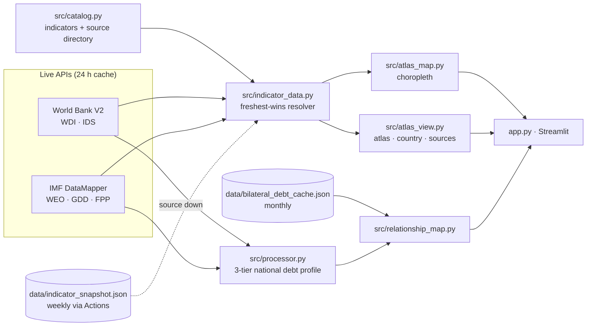

# 🌐 Global Debt & Fiscal Atlas

[](https://github.com/Jaudat150/global-debt-explorer/actions/workflows/tests.yml)
[](LICENSE)


[](CITATION.cff)

**Who owes what, who spends what — for every country, with the source and year of every number.**

An open-source atlas of sovereign debt, deficits, government spending, revenue, the economy and development, built
for students, researchers, journalists and anyone curious about public money. Data comes **live** from the World Bank
and IMF APIs; when a number is missing or out of date, the app tells you exactly where to find a better one.

<p align="center">
  <b>🗺️ Interactive app</b> · <a href="https://jaudat150.github.io/global-debt-explorer/"><b>🌐 Website: every country</b></a> ·
  <a href="docs/LIBRARY.md"><b>🐍 <code>pip install debt-atlas</code></b></a> · <a href="https://jaudat150.github.io/global-debt-explorer/data/"><b>⬇️ Data</b></a>
</p>

## Why this project

Public-finance data is scattered across a dozen institutions, each with its own codes, units, definitions and
release calendars. This atlas puts 37 indicators on one map while keeping what researchers need:

- **Provenance on every value** — source, series code, year, and whether it is an IMF estimate.
- **Freshness first** — when two series share a definition, the most recent valid value per country wins.
  Projections are never shown as data.
- **Honest gaps** — missing is never zero. Grey countries link to 31 curated sources for newer or
  more detailed data.
- **Works offline** — 24-hour caching, a weekly snapshot refreshed by GitHub Actions, and graceful fallback when an
  API is down.

## What you can do

| View | What it shows |
|---|---|
| 🗺️ **World atlas** | Choropleth map of any indicator; click a country to draw **who-owes-whom arrows** (lender → borrower, with amounts); top/bottom rankings; full table and CSV export with provenance; "find newer data" links. |
| 📊 **Country profile** | Headline numbers, **where the money goes** (defence, health, education, interest, R&D as % of GDP), a 25-year trend for any indicator, and links to the IMF, World Bank, budget documents and national statistics office. |
| 💸 **Spending** | What each government spends on defence, health, education, social transfers, wages, interest and R&D — in US$, per person and % of GDP, with the exact series behind every number — plus a world ranking for each line. |
| 🔗 **Who owes whom** | Bilateral lending from World Bank International Debt Statistics: arrows from every lender to the selected borrower **and** from the selected lender to everyone who owes it, with amounts, shares and each country's national debt profile. |
| 📚 **Data & sources** | Live freshness check of every indicator, one-click download of the full dataset, and the full source directory. |
| 🧑‍💻 **Developers** | One-click ZIP of all data with a Frictionless `datapackage.json`, every upstream API with live links and code examples (curl, Python, R), the project's Python API and CLI, and a full data dictionary. |

### Share any view

Every view has its own link, and the **🔗 Share** button copies it:

```text
?view=atlas&indicator=military_gdp&country=KEN     military spending map, Kenya selected
?view=spending&country=USA&item=health             where the US spends, health ranking
?view=debt&country=CHN                             who owes China, and whom China owes
```

### Indicators

| Category | # | Indicators |
|---|---|---|
| 🏦 **Debt & deficits** | 7 | Gov. debt, Fiscal balance, External debt, External debt / GNI, Debt service / exports, Interest / revenue, Private debt |
| 🧾 **Government spending** | 11 | Total spending, Military, Military / budget, Health, Health / budget, Education, Education / budget, Interest, R&D, Public wages, Subsidies & transfers |
| 💰 **Revenue & taxes** | 2 | Revenue, Tax revenue |
| 📈 **Economy** | 6 | GDP, GDP per capita, GDP growth, Inflation, Unemployment, Current account |
| 🌍 **External finance** | 4 | FDI inflows, Remittances, Aid received, Reserves cover |
| 👥 **People & development** | 4 | Population, Life expectancy, Extreme poverty, Inequality (Gini) |

Full definitions, series codes and links: **[docs/DATA_SOURCES.md](docs/DATA_SOURCES.md)**.

## Python library — `pip install debt-atlas`

```python
import debt_atlas as da

da.rank("military_usd", n=10)                     # biggest military spenders, US$
da.latest("gov_debt_gdp", countries=["Japan", "Italy", "USA"])
da.spending("United States")                      # where the money goes, in US$
da.who_owes("Kenya")                              # Kenya's lenders and how much
da.owed_by("China")                               # who owes China
da.series("inflation", "Argentina", start=2010)   # full history, per source
```

Lightweight (pandas only), cached, no API keys; accepts country names, ISO2 or ISO3. Also a command line:
`debt-atlas who-owes Pakistan`. Full reference: **[docs/LIBRARY.md](docs/LIBRARY.md)**.

## Website — a page for every country

[jaudat150.github.io/global-debt-explorer](https://jaudat150.github.io/global-debt-explorer/) has a fast, readable page for
every country (debt, spending, who it owes, who owes it, FAQ) and every indicator (full ranking with sources), rebuilt
weekly from the same validated data (`python -m src.website build`).

## Quick start

Python 3.11–3.13.

```bash
git clone https://github.com/Jaudat150/global-debt-explorer.git
cd global-debt-explorer
python -m venv .venv
source .venv/bin/activate            # Windows: .venv\Scripts\activate
pip install -r requirements.txt
streamlit run app.py
```

Open <http://localhost:8501>. The atlas, country profiles and sources work immediately. The **Who owes whom** view
needs the bilateral cache (`data/bilateral_debt_cache.json`, included; refresh with `python -m src.fetcher`).
Windows users: see [START_HERE_WINDOWS.txt](START_HERE_WINDOWS.txt).

### Deploy your own copy for free

1. Fork this repository.
2. On [Streamlit Community Cloud](https://streamlit.io/cloud), choose **New app**, select your fork and `app.py`.
3. Enable GitHub Actions on your fork so the weekly data snapshot keeps refreshing.

## How fresh is the data?

| Layer | Source | Refresh |
|---|---|---|
| Atlas indicators | World Bank WDI/IDS API, IMF DataMapper API | Live, cached 24 h; weekly snapshot via `refresh_indicators.yml` |
| National debt profile | World Bank → IMF → curated estimates → last-known snapshot | Live, cached 24 h |
| Bilateral debt | World Bank IDS (source 6) | Monthly via `update_data.yml` |

The IMF publishes the World Economic Outlook in April and October; values for the current year are IMF staff
estimates and are flagged (toggle **Reported data only** to hide them). The World Bank publishes WDI several times a
year and International Debt Statistics each December. When the live sources lag, the in-app **Find newer data**
panel and [docs/DATA_SOURCES.md](docs/DATA_SOURCES.md) list where newer figures appear first — usually national
statistics offices, ministries of finance, SIPRI, WHO and the IMF Fiscal Monitor.

## Open data for everyone

Every dataset is published as plain CSV with a [Frictionless Data Package](https://specs.frictionlessdata.io/data-package/)
descriptor, rebuilt weekly by GitHub Actions into [`data/exports/`](data/exports/README.md):

```python
import pandas as pd
base = "https://raw.githubusercontent.com/Jaudat150/global-debt-explorer/main/data/exports"
latest   = pd.read_csv(f"{base}/latest_values.csv")      # every indicator, every country, with provenance
spending = pd.read_csv(f"{base}/spending_usd.csv")       # where the money goes, in US$
history  = pd.read_csv(f"{base}/timeseries.csv.gz")     # full per-source time series
owes     = pd.read_csv(f"{base}/bilateral_debt.csv.gz") # who owes whom
```

Or build everything locally: `python -m src.exports build`, or use **Developers → Build the full data bundle** in the app.

## Using the data in research and teaching

- **CSV exports** from the atlas and the Data & sources view include ISO3, value, unit, year, estimate flag, source,
  series code, series URL and retrieval timestamp.
- **Command line:**

  ```bash
  python -m src.indicator_data show gov_debt_gdp KEN GHA ZMB   # one indicator, any countries
  python -m src.indicator_data refresh                         # download everything, update the snapshot
  python -m src.processor profiles SYR PSE CAN SAU             # national debt profiles with tier trail
  python -m src.catalog                                        # list every indicator and series code
  python -m src.exports build                                  # every dataset as CSV + datapackage.json
  python -m src.validate                                       # check coverage, reference figures, consistency
  ```

- **Cite** this project via [CITATION.cff](CITATION.cff) (GitHub shows a "Cite this repository" button) **and** the
  original data providers shown next to each value.

## Architecture



## Repository layout

```text
global-debt-explorer/
├── app.py                        # Streamlit entry point and view switcher
├── debt_atlas/                   # Python library (pip install debt-atlas)
├── pyproject.toml                # library packaging
├── src/
│   ├── catalog.py                # indicator catalogue + external source directory (pure data)
│   ├── indicator_data.py         # live download, 24 h cache, freshest-wins resolution, snapshot, CLI
│   ├── atlas_map.py              # choropleth + legend
│   ├── atlas_view.py             # World atlas, Country profile, Data & sources views
│   ├── debt_flows.py             # who-owes-whom: lender → borrower arrows and tables
│   ├── spending.py / spending_view.py   # where the money goes, in US$
│   ├── exports.py / developer_view.py   # open-data exports, datapackage.json, Developers tab
│   ├── website.py                # static SEO website (country + indicator pages, sitemap)
│   ├── validate.py · share.py    # data validation · shareable links
│   ├── fetcher.py                # World Bank IDS bilateral pipeline + national-profile API clients
│   ├── processor.py              # IDS processing + 3-tier national debt profiles
│   ├── relationship_map.py       # Who-owes-whom map
│   ├── map_geometry.py           # Natural Earth boundaries
│   └── ui_state.py
├── data/                         # caches, snapshots, label points (see data/README.md)
├── docs/DATA_SOURCES.md          # generated from src/catalog.py
├── tests/                        # network-free unit tests
├── .github/                      # CI, weekly/monthly data refresh, issue & PR templates
├── CITATION.cff · CONTRIBUTING.md · CODE_OF_CONDUCT.md · ROADMAP.md · CHANGELOG.md · LICENSE
```

## Methodology details

### National debt profile: 3-tier fallback

The national-profile layer is independent of the bilateral IDS cache. For **every** ISO-3 code, `src/processor.py` resolves a profile in this order and never raises because of a network failure:

| Tier | Source | Indicator | Returned metric |
|---|---|---|---|
| 1 — Primary | World Bank V2 API | `DT.DOD.DLXF.CD` | Long-term external debt stocks, current US$ |
| 2 — Secondary | IMF DataMapper API | `GGXWDG_NGDP` (World Economic Outlook), then `GG_DEBT_GDP` (Global Debt Database) | General government gross debt, % of GDP |
| 3 — Safety net | a) `LOCAL_FALLBACK_DB` · b) last-known-good snapshot | Curated, sourced estimates · last value retrieved from a live source | The metric stated by the record |
| — | none of the above | — | Explicit `No verified data` profile (never zero), still plotted |

A tier is skipped — and the next one tried — when its source is **unreachable**, has **no non-null value**, returns **zero/negative/non-numeric** data, or its latest observation is **older than 10 years** (`GDE_MAX_OBSERVATION_AGE_YEARS`). Each profile carries a `resolution_trail`, e.g. `Tier 1 World Bank: no non-null observation → Tier 2 IMF: latest non-null observation used`, which the dashboard shows under the country panel.

#### Tier 1 — World Bank

```text
https://api.worldbank.org/v2/country/{ISO3}/indicator/DT.DOD.DLXF.CD?format=json
```

The parser reads the observation array at index `[1]` and selects the latest year with a non-null value. For the map, one paginated `country/all` request replaces ~250 single-country calls; if that bulk request fails, the exact per-country route above is queried concurrently behind a circuit breaker (it stops after 5 consecutive failures so an outage costs seconds, not minutes).

**Definition:** `DT.DOD.DLXF.CD` is long-term external debt — public, publicly guaranteed **and** private nonguaranteed — not public debt alone. High-income creditor countries such as Canada and Saudi Arabia do not report to IDS, so they normally resolve at Tier 2. See the [World Bank debt-statistics FAQ](https://www.worldbank.org/en/programs/debt-statistics/faq).

#### Tier 2 — IMF DataMapper

```text
https://www.imf.org/external/datamapper/api/v1/GG_DEBT_GDP
```

The full payload is downloaded once and read at `data["values"]["GG_DEBT_GDP"][code]`.

- **Projections excluded.** DataMapper series include World Economic Outlook forecasts up to five years ahead. Years after the current year are ignored, so a 2030 forecast is never shown as the latest value. Current-year values are flagged as IMF staff estimates.
- **Code aliases.** The IMF uses `WBG` for West Bank and Gaza and `UVK` for Kosovo; these are translated automatically.
- This is a **ratio**, displayed as `% of GDP`, and is never ranked against US$ stocks. See the [IMF DataMapper API](https://www.imf.org/external/datamapper/api/).

#### Tier 3 — local safety net

**a) Curated estimates — `LOCAL_FALLBACK_DB`.** Used when both live tiers come up empty:

- **Syria (`SYR`):** US$20–23B estimated total external debt (range attributed to the post-2024 government), reported by [PIIE](https://www.piie.com/blogs/realtime-economics/2025/syria-needs-debt-restructuring-will-be-difficult) and the [EUAA](https://www.euaa.europa.eu/coi/syria/2025/country-focus/3-socio-economic-situation-focus-damascus-city/31-economic-situation-overview). PIIE describes the World Bank's figure (~US$4.1B, 2023) as very incomplete.
- **West Bank and Gaza (`PSE`):** US$4.8B Palestinian Authority public debt at end-2025, [World Bank Palestinian Economic Monitor](https://thedocs.worldbank.org/en/doc/caf69bb9db6d729c6b35254c5815df9a-0280012026/original/Palestinian-Economic-Monitor-5-19-26web.pdf) (May 19, 2026). Excludes large arrears.

Each record keeps its value or range, metric type, observation year, source URL, source publication date, review date (`reviewed_at`) and a perimeter caveat. When a live tier *does* return a value for one of these countries, the curated figure is not discarded: it is attached as `alternative_estimate` and shown as "Other estimate". Set `"prefer_over_live": True` on an entry only if you have a documented reason to rank it above the live series.

To add a country, append a record with the same fields. Add one only when a credible source, value or range, period and source date can be recorded.

**b) Last-known-good snapshot.** Every successful live response is merged into `data/country_profiles_snapshot.json`. If the World Bank or IMF is **unreachable** (not merely "no data"), the last known value is used, labelled `Last retrieved YYYY-MM-DD · live source unreachable`. The monthly GitHub workflow refreshes this file; you can also run `python -m src.processor profiles`.

#### Stable country-profile contract

Every valid ISO-3 code returns a profile with at least:

- `iso3`, `country_name`
- `value`, `value_low`, `value_high`, `display_value`
- `metric_type`, `metric_label`, `metric_short`, `unit`, `observation_year`
- `source_label`, `data_source`, `source_url`, `source_timestamp`, `source_date_label`
- `fallback_tier`, `tier_label`, `is_estimate`, `is_stale_snapshot`, `data_available`
- `coordinates` (`{"latitude", "longitude"}`), `map_available`, `definition_note`
- `resolution_trail`, `alternative_estimate`

Coordinates come from `data/country_label_points.json` (Natural Earth 1:10m label points, 241 economies, including small states absent from the 1:110m outlines). The map prefers a polygon's representative point where one exists. Natural Earth's own codes for Palestine (`PSX`), South Sudan (`SDS`), Kosovo (`KOS`) and Western Sahara (`SAH`) are translated to ISO codes so those countries match their data.

#### Caching, outages and refresh

- Live API responses are cached with `@st.cache_data(ttl=86400)` — 24 hours ([docs](https://docs.streamlit.io/develop/api-reference/caching-and-state/st.cache_data)).
- **Failures are never cached:** a failed call raises inside the cached function, so Streamlit stores nothing. A 5-minute in-process back-off then stops the dead source from adding timeout latency to every rerun.
- If both live APIs are down, the dashboard shows a banner and runs on Tier 3.
- **Refresh country data** clears the 24-hour cache and the back-off.
- Request timeouts: 5 s connect / 20 s read, up to 3 attempts with exponential back-off honouring `Retry-After`.

#### Debugging a country from the command line

```cmd
python -m src.processor profiles CAN SAU SYR PSE
python -m src.processor profiles SYR --json
```

Prints each country's tier, value and source; `--json` includes the full resolution trail.

### Bilateral IDS data (Who owes whom)

The bilateral relationship map continues to use World Bank International Debt Statistics (IDS), source ID `6`, indicator `DT.DOD.BLAT.CD` — *PPG, bilateral (DOD, current US$)*.

| Field | Definition |
|---|---|
| Debtor | Reporting economy in the IDS debtor dimension |
| Creditor | IDS `counterpart-area` identifier and label |
| Amount | Public and publicly guaranteed bilateral debt outstanding and disbursed, current US dollars |
| Time | Annual observation year |

`src/fetcher.py` retrieves counterpart-area metadata, sends semicolon-delimited creditor ID batches, follows pagination, retries transient errors, and recursively splits batches rejected by the API. It requests `time/all` then filters the requested year range locally. The default start year is 2000; use `--start-year 1960` for a longer history.

The monthly GitHub Actions workflow refreshes this bilateral cache and the country-profile snapshot. National country profiles are requested by the dashboard and cached for 24 hours at runtime.

### Map tiles

The default basemap uses OpenStreetMap Standard tiles and keeps the required attribution visible. Follow the [OpenStreetMap tile usage policy](https://operations.osmfoundation.org/policies/tiles/); the public tile service is best-effort and is not intended for heavy production traffic. For public deployments with more traffic, use a dedicated tile provider or host your own tiles.

Optional CARTO Positron support is available with a user-provided API key. Never commit keys:

```cmd
set GDE_MAP_BASEMAP=carto
set CARTO_BASEMAP_API_KEY=YOUR_PERSONAL_KEY
python -m streamlit run app.py
```

Without a key, the app automatically uses OpenStreetMap.

## Tests

```bash
python -m unittest discover -s tests -v
```

The suite is network-free (all HTTP is mocked) and covers API parsing, projection and estimate handling,
freshest-wins resolution, outage back-off, snapshots, colour classification, maps, the 3-tier national profile and
the bilateral pipeline. CI runs it on Python 3.11, 3.12 and 3.13 and checks that `docs/DATA_SOURCES.md` matches the
catalogue.

## Team

Created and led by **Jaudat Faisal Al-Husein** ([@Jaudat150](https://github.com/Jaudat150)). Maintainers, roles and how
the team works: [docs/TEAM_PLAYBOOK.md](docs/TEAM_PLAYBOOK.md).

## Contributing

Contributions of every size are welcome — reporting a stale number is as valuable as code. Adding an indicator is
usually about ten lines in `src/catalog.py`. See [CONTRIBUTING.md](CONTRIBUTING.md) and [ROADMAP.md](ROADMAP.md).

## Licence and data attribution

Code: [MIT](LICENSE). Data remain subject to their providers' terms:
[World Bank](https://www.worldbank.org/en/about/legal/terms-of-use-for-datasets) (CC BY 4.0),
[IMF](https://www.imf.org/external/terms.htm), SIPRI, WHO, UNESCO and the other sources listed with each value.
Boundaries: [Natural Earth](https://www.naturalearthdata.com/) (public domain). Map tiles:
[© OpenStreetMap contributors](https://www.openstreetmap.org/copyright).

## Author

Created and maintained by **Eng. Jaudat Faisal Al-Husein** · [github.com/Jaudat150](https://github.com/Jaudat150) ·
jaudatalhusein@gmail.com
